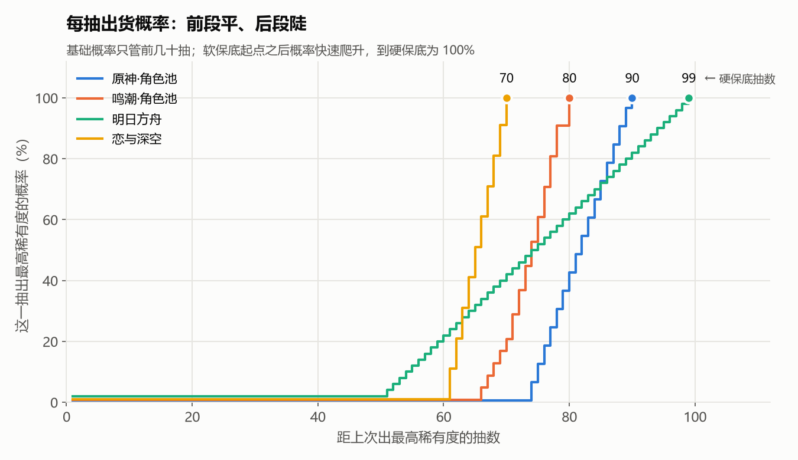
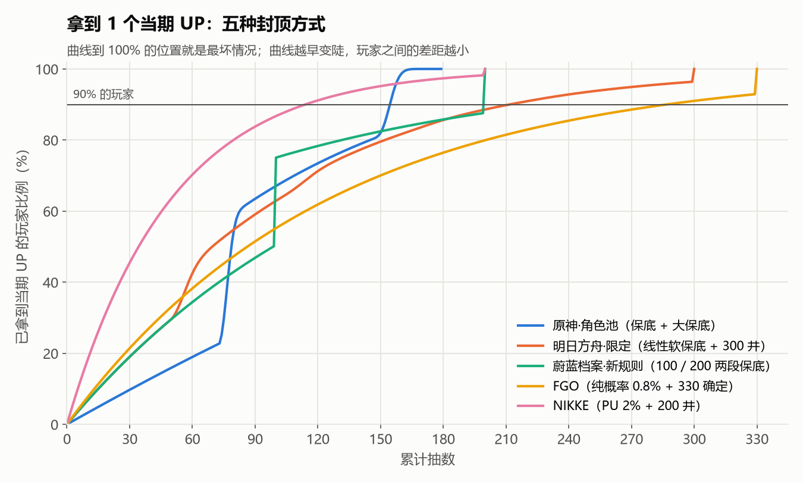

# 二游抽卡概率的数值设计

> 整理：Claude ｜ 2026-11-25
>
> 一句话：公示的基础概率只决定运气好的玩家多快出货，真正决定花费的是三个结构：软保底把出货压进一个窄窗口，大保底给期望乘上一个倍率，井把最坏情况封顶。设计时先定「拿到 1 个 UP 的期望抽数和最坏抽数」，再反推这三个旋钮。

## 标注约定

- **【公示】**：游戏内概率公示或官方公告里的数字。
- **【计算】**：按公示规则，用本目录的 [`抽卡计算_Claude.py`](抽卡计算_Claude.py) 精确算出，可复现。
- **【社区】**：玩家统计、攻略站或社区维基的说法，官方没有公布或没能核到官方原文。
- **【推断】**：本文的解读或通用推导。

规则以 2026 年 11 月为准。各游戏的规则经常调整，引用前请以游戏内公示为准。

## 0. 结论

1. **综合概率不等于基础概率。** 原神 5★ 基础概率 0.6%，公示综合概率 1.6%【公示】。按社区模型，只有 35.6% 的 5★ 出在第 74 抽之前，其余 64% 集中在第 74–90 抽这 17 抽里【计算】。
2. **软保底的作用是压低方差，不是让利。** 同样是平均 62.3 抽出一次，纯概率的 P90 是 143 抽、P99 是 285 抽；原神式曲线的 P90 是 80 抽、P99 是 83 抽【计算】。
3. **UP 规则是期望的倍率。** 100% UP 为 ×1，75% + 大保底为 ×1.25，50% + 大保底为 ×1.5，50% 且没有大保底为 ×2。原神「捕获明光」把小保底的有效 UP 率提到 55%，倍率降到 1.45【公示】【计算】。
4. **封顶有两种做法。** 保底式封住「出一次最高稀有度要多少抽」，再用大保底把拿到 UP 的最坏情况控制在 60–180 抽（国产主流）。井式直接封住「拿到 UP 要多少抽」，日韩主流是 200–330 抽。拿到 1 个当期 UP 的期望，两类大多都在 50–120 抽之间【计算】。
5. **井真正被用到的比例取决于 PU 概率。** PU 0.7% + 200 抽井，约 25% 的玩家要抽满 200 抽；PU 2%（NIKKE）只有 1.8%。PU 越高，井越接近一张安全网，对期望的影响越小【计算】。
6. **近两年的改动以压尾部为主。** 原神 2024-08 加入「捕获明光」；FGO 的 330 抽确定召唤从每池一次改为可重复（日服 2024-08，国服 2025-07）；蔚蓝档案日服 2026-07、国际服 2026-11 改成「100 抽 50% / 200 抽必得」两段保底并跨池继承；明日方舟 2026 年把部分往期限定的兑换价从 300 降到 200【公示】【社区】。捕获明光让单份期望降 3.3%，FGO 改为可重复不改变单份期望，主要变化都在 P90 和最坏情况；蔚蓝档案是例外，单份期望降了 16%【计算】。
7. **单抽价差近一倍，拿一个角色的花费却很接近。** 国服单抽价从 11.7 元（明日方舟）到 22.4 元（崩坏3），但按非首充最大档折算，各家角色池拿到 1 个当期 UP 的期望花费都落在 1,000–1,200 元。崩坏3 单抽贵，但 90 抽必得当期 S 级，期望抽数只有 50 抽左右【计算】。
8. **定参数的顺序**：先定期望线和最坏线，再配曲线形状和 UP 规则，最后用综合概率反查、写进公示（第 6 节）【推断】。

## 1. 抽卡系统的部件

| 部件 | 作用 | 样本 |
|---|---|---|
| 基础概率 | 每抽出最高稀有度的初始概率 | 0.5%–5%；FGO ★5 从者 1%，蔚蓝档案 ★3 3%，学园偶像大师 SSR 5% |
| 软保底 | 连续若干抽没出货后，每抽概率逐步提高 | 明日方舟第 51 抽起每抽 +2%；恋与深空第 61 抽起每抽 +10% |
| 硬保底 | 第 H 抽必出最高稀有度 | 60、70、80、90 抽 |
| 小保底 / 大保底 | 出最高稀有度时有 q 的概率是 UP；没中（俗称「歪」），下一次必定是 UP | q = 50% 或 75% |
| 歪后补偿 | 本该歪的那一次另有概率改判为 UP | 原神「捕获明光」 |
| 定轨 | 多个 UP 时先选定目标，没抽到就积累点数，满点必得目标 | 原神武器池，命定值 1 点 |
| 井（天井） | 每抽积累兑换点，满 S 点直接兑换 UP | 200 抽（赛马娘、NIKKE）、300 抽（碧蓝幻想） |
| 确定召唤 | 连续 S 抽没出 UP 时直接给 UP，计数只在出 UP 时重置 | FGO 330 抽、第七史诗 121 抽 |
| 十连保底 | 每 10 抽至少一个次高稀有度 | 4★ / SR 及以上 |
| 保底继承 | 保底计数和大保底状态是否带到下一期同类池子 | 国产保底式大多继承；日韩井大多每期清零 |
| 多 UP 分配 | 同期多个 UP 时怎么分 UP 份额 | FGO 双 PU 各 0.4%（平分）；赛马娘双 PU 各 0.75%（不平分） |

两条主流路线【推断】：

- **保底式**：基础概率低，用软/硬保底加大保底封顶。原神、星穹铁道、绝区零、鸣潮、恋与深空、重返未来：1999 属于这一类。
- **井式**：基础概率较高，出货本身没有保底，抽满固定次数可以直接拿到 UP。FGO、赛马娘、公主连结、碧蓝幻想、NIKKE 属于这一类。

明日方舟（软保底 + 300 井）、终末地（软保底 + 120 抽必得）、蔚蓝档案新规则（两段保底）介于两者之间。

## 2. 数学模型

### 2.1 每抽概率曲线

设距上次出最高稀有度已经是第 k 抽，这一抽出货的概率为 p(k)：

```
p(k) = 基础概率                              k < 软保底起点 s
p(k) = 基础概率 + 增量 × (k − s + 1)          s ≤ k < 硬保底 H
p(H) = 1
```

出一次最高稀有度需要的抽数 N 的分布：

```
P(N = k) = p(k) × Π_{j<k} (1 − p(j))
E[N]     = Σ k × P(N = k)
综合概率  = 1 ÷ E[N]
```

公示的「综合概率（含保底）」就是 1 ÷ E[N]，即长期平均下每抽出货的比例。软保底参数官方通常不公布，但可以拿它反查：按社区测出的参数算出来的综合概率和公示一致，说明参数基本可信（见 4.4）【推断】。



*图 1：原神角色池和鸣潮的软保底参数是社区模型；明日方舟是官方规则；恋与深空取自国际服的官方说明。*

### 2.2 UP 层

出了最高稀有度之后，是不是 UP 由一个小状态机决定，和这是第几抽无关。所以：

```
拿到 1 个 UP 的期望抽数 = E[N] × E[M]
```

M 是拿到 UP 需要出几次最高稀有度：

| UP 规则 | E[M] | 最坏情况 |
|---|---|---|
| 100% 是 UP | 1 | H |
| 75% + 大保底 | 1.25 | 2H |
| 55% + 大保底 | 1.45 | 2H |
| 50% + 大保底 | 1.5 | 2H |
| q，没有大保底 | 1 ÷ q | 无上限 |

公示的「UP 综合概率」正好等于这个式子：原神公示的 UP 5★ 综合概率 1.103% = 1.6% ÷ 1.45；绝区零公示的限定 S 级综合概率 1.067% = 1.6% ÷ 1.5【公示】【计算】。

### 2.3 井和确定召唤

- **井**：拿到 UP 的抽数 = min(随机拿到 UP 的抽数, S)。出货没有保底、单抽 UP 概率为 u 时，抽满 S 抽才拿到的玩家占 (1 − u)^(S−1)。
- **确定召唤**：相当于只对 UP 设一道硬保底，计数只在出 UP 时重置。FGO 的 330 抽和第七史诗的 121 抽都属于这一类。

### 2.4 多份

命座、星魂、宝具、凸这类重复抽取，每一份都要重新走一遍 UP 层。大保底状态会跨份延续，期望近似为单份期望 × 份数；份数越多，分布越集中（见 3.5）。

### 2.5 计算方法

文中【计算】的数字都由 [`抽卡计算_Claude.py`](抽卡计算_Claude.py) 精确算出：逐抽推进「保底计数 × 大保底状态 × 已拿份数」的概率分布，不是抽样模拟。用 10 万次蒙特卡洛交叉检验过三组参数，期望误差小于 0.3 抽。脚本只依赖 Python 标准库；画图需要 matplotlib。

## 3. 设计实验：一次只动一个旋钮

### 3.1 同样的期望，三种曲线形状【计算】

| 曲线 | 期望 | 标准差 | P10 | 中位数 | P90 | P99 |
|---|---|---|---|---|---|---|
| 纯概率（每抽 1.605%） | 62.3 | 61.8 | 7 | 43 | 143 | 285 |
| 只有硬保底（每抽 0.882%，90 抽必出） | 62.3 | 31.4 | 12 | 79 | 90 | 90 |
| 原神式（0.6% + 74 抽起软保底 + 90 抽必出） | 62.3 | 24.3 | 18 | 76 | 80 | 83 |

三条曲线平均都是 62.3 抽出一次，但体验完全不同：

- 纯概率下，10% 的玩家 7 抽内出货，另有 10% 的玩家要 143 抽以上。
- 原神式把 80% 的玩家压在 18–80 抽之间。
- 代价是中位数从 43 抽推到 76 抽，多数玩家要进入软保底区间才出货。

### 3.2 软保底的起点和斜率【计算】

基础概率 0.6%，90 抽必出，每抽 +6%，只改软保底起点：

| 软保底起点 | 综合概率 | 期望 | 中位数 | P90 |
|---|---|---|---|---|
| 60 | 1.882% | 53.1 | 62 | 66 |
| 66 | 1.750% | 57.1 | 68 | 72 |
| 70 | 1.674% | 59.8 | 72 | 76 |
| 74 | 1.605% | 62.3 | 76 | 80 |
| 78 | 1.544% | 64.8 | 80 | 84 |
| 82 | 1.489% | 67.2 | 84 | 88 |
| 86 | 1.447% | 69.1 | 87 | 90 |

起点从 74 抽起只改每抽增量：

| 每抽增量 | 综合概率 | 期望 | P90 |
|---|---|---|---|
| +2% | 1.549% | 64.5 | 86 |
| +4% | 1.587% | 63.0 | 82 |
| +6% | 1.605% | 62.3 | 80 |
| +10% | 1.624% | 61.6 | 78 |

起点每推后 4 抽，期望增加约 2.5 抽，中位数和 P90 同步后移 4 抽。增量对期望影响很小，主要决定软保底区间有多宽：+2% 时出货散在 74–86 抽，+10% 时集中在 74–78 抽。

### 3.3 UP 规则【计算】

稀有度层统一用原神式曲线：

| UP 规则 | 期望 | 倍率 | 中位数 | P90 | P99 | 最坏 |
|---|---|---|---|---|---|---|
| 100% 是 UP | 62.3 | ×1.00 | 76 | 80 | 83 | 90 |
| 75% + 大保底 | 77.9 | ×1.25 | 77 | 150 | 160 | 180 |
| 55% + 大保底（捕获明光的近似） | 90.3 | ×1.45 | 79 | 155 | 161 | 180 |
| 50% + 大保底 | 93.4 | ×1.50 | 80 | 155 | 161 | 180 |
| 50%，没有大保底 | 124.6 | ×2.00 | 81 | 239 | 465 | 无上限 |

UP 规则几乎不改变中位数（76–81 抽），差别全在尾部：P90 从 80 抽翻到 150 抽以上。大保底的作用是把尾部封在 2H。

### 3.4 井【计算】

出货没有保底，单抽 UP 概率为 u，抽满 S 抽可兑换：

| PU 概率 | 井 | 无井期望 | 无井 P90 | 有井期望 | 有井中位数 | 抽满井的人 |
|---|---|---|---|---|---|---|
| 0.40% | 300 | 250.0 | 575 | 174.9 | 173 | 30.2% |
| 0.50% | 200 | 200.0 | 460 | 126.6 | 139 | 36.9% |
| 0.70% | 200 | 142.9 | 328 | 107.8 | 99 | 24.7% |
| 0.75% | 200 | 133.3 | 306 | 103.8 | 93 | 22.4% |
| 1.20% | 200 | 83.3 | 191 | 75.9 | 58 | 9.0% |
| 2.00% | 200 | 50.0 | 114 | 49.1 | 35 | 1.8% |

- PU 0.7% 左右时，井同时压低了期望（−25%）和尾部，约四分之一的玩家会用到它。
- PU 2% 时井几乎不影响期望，只是保险。
- 井的抽数接近 1 ÷ u 时，「抽满井的人」超过三分之一，此时井本身就成了主要获取方式【推断】。

### 3.5 多份【计算】

原神角色池，小保底按 55% 近似：

| 份数 | 期望 | P10 | 中位数 | P90 | 最坏 | P90 ÷ 期望 |
|---|---|---|---|---|---|---|
| 1 | 90.3 | 31 | 79 | 155 | 180 | 1.72 |
| 2 | 180.7 | 100 | 174 | 253 | 360 | 1.40 |
| 3 | 271.0 | 175 | 269 | 373 | 540 | 1.38 |
| 7 | 632.3 | 488 | 631 | 778 | 1260 | 1.23 |

单份的 P90 是期望的 1.72 倍；满命（7 份）只有 1.23 倍，最坏情况（1,260 抽）几乎不可能出现。所以给重度付费玩家做价格锚点时，用「期望 × 份数」误差不大；给零氪、轻度玩家估单份时，要看 P90 而不是期望【推断】。

### 3.6 次高稀有度的十连保底【计算】

原神 4★ 基础 5.1%，公示「最多 10 抽必出 4★」，综合概率 13.000%【公示】。

- 只按第 10 抽必出计算，综合概率只有 12.51%，和公示对不上。
- 社区模型在第 9 抽把概率提到 56.1%，算出 13.06%，和公示吻合。

说明十连保底前一抽还有一档软保底【推断】。这也是用公示综合概率反查隐藏参数的一个例子。

## 4. 各游戏规则

### 4.1 保底式

| 游戏 · 池子 | 基础概率 | 公示综合概率 | 软保底 | 硬保底 | UP 规则 | 保底继承 |
|---|---|---|---|---|---|---|
| 原神 · 角色活动祈愿 | 0.6% | 1.6% | 第 74 抽起每抽 +6%【社区】 | 90 | 50% + 大保底；小保底歪时可能触发「捕获明光」改判为 UP，有效 UP 率 55%；连续三次走大保底后下一次必触发 | 所有角色活动祈愿之间继承，含大保底状态 |
| 原神 · 神铸赋形（武器） | 0.7% | 1.85% | 第 63 抽起 +7%，第 74 抽起 +3.5%【社区】 | 80 | 75% 为两把 UP 之一；定轨，命定值满 1 点必得定轨武器（5.0 起由 2 点改为 1 点） | 抽数继承，命定值每期清零 |
| 原神 · 集录祈愿 | 0.6% | 1.6% | 未单独统计 | 90 | 从全部 5★ 中自选 1 个定轨，50% + 命定值 1 点 | 抽数继承（与溯光祈愿共享），命定值每期清零 |
| 星穹铁道 · 角色活动跃迁 | 0.6% | 1.6% | 沿用原神模型【社区】 | 90 | 50% + 大保底；3.2 起「星缘相邀」可自定义歪池 | 所有角色活动跃迁之间继承 |
| 星穹铁道 · 光锥活动跃迁 | 0.8% | 1.87% | 第 66 抽起 +7%【社区】 | 80 | 75% + 大保底 | 继承 |
| 绝区零 · 独家频段 | 0.6% | 1.6% | 未找到统计 | 90 | 50% + 大保底 | 继承 |
| 绝区零 · 音擎频段 | 1.0% | 2.0% | 存在，参数未知【推断】 | 80 | 75% + 大保底 | 继承 |
| 崩坏3 · 角色补给 | 游戏外未公开（社区说法 1.5% 或约 1.37%） | 游戏外未公开 | 没有【社区】 | 90（7.3 起，之前 100） | 90 抽必得当期 S 级；每 10 次必得 A 级或以上 | 获得后重新计数；跨期是否继承，公告未写 |
| 鸣潮 · 角色活动唤取 | 0.8% | 1.8% | 第 66 抽起分段递增【社区】 | 80 | 50% + 大保底 | 所有角色活动唤取之间继承 |
| 鸣潮 · 武器活动唤取 | 0.8% | 1.8% | 同角色池【社区】 | 80 | 100% UP | 继承 |
| 明日方舟 · 标准 / 中坚寻访 | 2% | 不公布（算出 2.89%） | 连续 50 抽未出时第 51 抽升到 4%，之后每抽 +2% | 99（由规则推出） | 两名 UP 合占 50%；累计 150 抽后下一个 6★ 必为 UP 之一，累计 300 抽后必为另一名，各生效一次 | 概率递增计数在同类寻访间继承；150/300 抽计数每期清零 |
| 明日方舟 · 限定寻访 | 2% | 同上 | 同上 | 99 | 限定干员与同期 UP 合占 70%，没有大保底；累计 300 抽额外送一次限定干员；每抽得 1 张契约，300 张兑换（较早的限定 200 张） | 每期清零 |
| 明日方舟：终末地 · 特许寻访 | 0.8%【社区】 | 未公示 | 第 66 抽起 +5%【社区】 | 80 | 50%，没有大保底；每期前 120 抽必得 UP 一次；每 240 抽送 UP 干员的「信物」（突破道具，不是角色本体） | 80 抽计数是否跨池，说法矛盾 |
| 恋与深空 · 限定思念 | 1% | 2.1% | 连续 60 抽未出，第 61 抽起每抽 +10%【公示·国际服】 | 70 | 50% + 大保底；混池为五选三占 75% 并可定向；混池累计 200 抽自选 1 张 | 限定许愿之间继承 |
| 重返未来：1999 · 限时征集 | 1.5% | 2.36% | 第 61 抽升到 4%，之后每抽 +2.5% | 70 | 50% + 大保底 | 限时征集之间继承；真限定池清零【社区】 |
| 少女前线2 · 定向采购 | 0.6% | — | 第 59 抽起提升，幅度不公布 | 80 | 50% + 大保底 | 定向采购之间继承 |
| 少女前线2 · 军备提升（武器） | 0.7% | — | 第 51 抽起提升，幅度不公布 | 70 | 75% + 大保底 | — |
| 尘白禁区 · 特选角色共鸣 | 未公布 | — | — | 100（必得选定角色） | 100% 选定目标 | 同类共鸣之间继承 |
| 尘白禁区 · 标准角色共鸣 | 未公布 | — | — | 80 | 50% + 大保底 | 同类共鸣之间继承 |
| 战双帕弥什 · 主题角色研发 | 0.5%（2019 年公示） | 1.9% | 没有（见 4.4） | 60 | 100% UP | 同名卡池之间继承 |
| 幻塔 · 限定武器订购 | 0.75% | 2% | — | 80（只保 SSR） | 出 SSR 时是否 50% 为限定未核实；每抽送代币，120 个兑换 UP 武器 | — |
| 异环 · 限定 UP 池（整行为攻略站说法） | 0.99%【社区】 | 约 1.87%【社区】 | 第 71 抽起单抽概率跳到约 19.5% | 90 | 100% UP，不会歪 | 跨期继承 |
| 无限暖暖 · 限定共鸣 | 1.5%（单件部件） | 6.06% | 存在，参数未知【推断】 | 20 | 优先出未拥有的部件；9 件套最坏 180 抽集齐 | — |

除标注外，数字均来自【公示】或官方公告转载。其中米哈游三款取自游戏内「祈愿 / 跃迁 / 调频详情」页的公开数据。少女前线2、尘白禁区的部分规则来自社区维基对游戏内说明的转载。

### 4.2 井式与混合式

| 游戏 · 池子 | 最高稀有度概率 | PU 单抽概率 | 封顶 | 计数规则 | 依据 |
|---|---|---|---|---|---|
| FGO（日服、国服） | ★5 从者 1% | 单 PU 0.8%；双 PU 各 0.4% | 第 330 抽必得 PU。日服 2022-01 上线，2024-08 起可重复触发；国服 2025-07 起可重复触发 | 只在出 PU 时重置；不跨池 | 规则【公示】，概率【社区】 |
| 赛马娘（日服） | ☆3 3% | 0.75%；双 PU 仍各 0.75% | 200 Pt 兑换 | 每池独立；2024-10 起，≥200 Pt 时池结束后仍可兑换 | 【社区】 |
| 公主连结（日服） | ★3 3%（Fes 6%） | 0.7% | 200 Pt 兑换（2021-03 由 300 降到 200） | 期满转为其他道具 | 【社区】 |
| 碧蓝幻想（日服） | SSR 3%（Fes 6%） | 未核实 | 300 抽兑换 | 期满转为其他道具 | 【社区】 |
| 世界计划（日服） | ★4 3%（Fes 6%） | 0.4% | 贴纸兑换，2022 年实例为 300 枚 | 有交换期限 | 兑换机制【公示】，数字【社区】 |
| 学园偶像大师（日服） | SSR 5% | PU 偶像 0.75% | 200 Pt 兑换 | 同期 PU 池共用，池结束转道具 | 【社区】 |
| 蔚蓝档案（日服 2026-07 起；国际服 2026-11 起） | ★3 3%（Fes 6%） | 0.7% | 第 100 抽必出 ★3 且 50% 为 PU；第 200 抽必得 PU | 只在出 PU 时重置；跨池继承；通常池与限定池两套计数 | 【社区】（媒体报道官方公告） |
| 蔚蓝档案（国服，截至 2026-06 公告） | ★3 3% | 0.7% | 200 点兑换 | 每期清零 | 【公示】（搜索摘要） |
| NIKKE（国际服、国服） | SSR 4% | 2%（部分类型 1%） | 200 张券兑换 | 券跨池保留 | 国服【公示】，国际服【社区】 |
| 第七史诗 · PU 召唤 | 5★ 英雄 1%，PU 池只出 PU（另一说合计 1.25%） | 1% | 第 121 抽必得 | 每池清零 | 【公示】（官方公告转载） |
| 第七史诗 · 神秘召唤 | — | 月光 5★ 0.625% | 第 201 抽必得 | 跨池继承 | 【社区】 |
| 碧蓝航线 · 限时建造（国服） | — | UP UR 1.2%（2023-09 实例） | 每累计 200 次得 UP | 每期清零 | 【公示】 |

### 4.3 结构特殊的几款

- **阴阳师**：常驻召唤 SSR 1%、SP 0.25%，没有保底【公示】。新式神的 UP 活动按期规定【公示，媒体转载】：
  - 60 抽内必出 SSR/SP。
  - 指定式神的初始概率为 3%（SSR 全图鉴玩家 10%），之后持续提升。
  - 800 抽必得指定式神，全图鉴玩家 450 抽。
  - 累计 520 抽送一次限定范围内的自选。

  图鉴完成度直接折算成抽卡成本，是给老玩家的隐性优惠【推断】。
- **无限暖暖**：出的是服装部件而不是角色，优先出未拥有的部件，所以「歪」变成了「重复」。9 件套的期望是 9 ÷ 6.06% ≈ 149 抽，最坏 180 抽【计算】。
- **常驻池的累计自选**：星穹铁道「群星跃迁」和绝区零常驻频段累计 300 抽可自选一名常驻最高稀有度，各限一次【公示】【社区】。
- **二重螺旋**：2025-08 宣布公测版取消角色和武器抽卡、取消星级，改为外观付费【社区，媒体报道】。可以作为「不靠抽卡」的对照组。
- **崩坏3**：
  - 7.3 版本（2024-02）改版：扩充补给更名为角色补给，单次 280 水晶不变；必得当期 S 级的保底从 100 抽降到 90 抽，获得后重新计数；同时移除碎片能量机制和补给里的碎片产出【公示】。90 抽规则已在官网 7.3 更新公告原文核实，其余几条来自官方前瞻公告的转载，本次只见搜索摘要。
  - 之后每期角色补给的公告都写「每 10 次必得 A 级或以上，至多 90 次必得当期 S 级」【公示】。
  - 7.3 上线的协同补给，活动期间至多 60 次必得 S 级协同者【公示】；装备补给的武器保底为 60 抽【社区】。
  - 官网公示了常驻「标配补给」的概率：S 级女武神 1.50%、A 级 13.50%、B 级 5.50%，角色卡合计 20.50%【公示】。
  - 角色补给的 S 级概率只在游戏内补给详情页，游戏外没找到原文。社区有两种说法：一种说改版后基础概率仍是 1.5%；另一种说综合概率维持旧规则的 1.925%，等于基础概率降到约 1.37%【社区】。两种算出的期望只差 2.4 抽（49.6 对 52.0），5.1 两种都列出。
  - 崩坏3 没有软保底【社区】，是 3.1 里「只有硬保底」的形状：约 26%–29% 的玩家要抽满 90 抽，远高于原神式曲线。

### 4.4 用公示综合概率反查软保底【计算】

| 模型 | 算出的综合概率 | 公示 | 判断 |
|---|---|---|---|
| 原神 · 角色（74 抽起 +6%） | 1.605% | 1.600% | 吻合 |
| 原神 · 武器（社区模型） | 1.878% | 1.850% | 略高，模型可能高估 |
| 星铁 · 光锥（66 抽起 +7%） | 1.872% | 1.870% | 吻合 |
| 星铁 · 光锥（63 抽起 +7%） | 1.936% | 1.870% | 不符，排除这个说法 |
| 鸣潮（社区分段模型） | 1.848% | 1.8% | 略高 |
| 鸣潮（只有硬保底） | 1.688% | 1.8% | 偏低，说明有软保底 |
| 明日方舟 | 2.891% | 不公布 | — |
| 恋与深空 | 2.117% | 2.1% | 吻合 |
| 重返未来：1999 | 2.359% | 2.36% | 吻合 |
| 战双（只有硬保底） | 1.925% | 1.9% | 吻合，说明没有软保底 |
| 绝区零 · 音擎（只有硬保底） | 1.810% | 2.0% | 偏低，说明有软保底 |
| 无限暖暖（只有硬保底） | 5.750% | 6.06% | 偏低，说明有软保底 |

## 5. 成本对比

### 5.1 保底式：拿到 1 个当期 UP【计算】

| 池子 | 期望（按公示综合概率） | 期望（按曲线） | 中位数 | P90 | 最坏 | 期望花费（元） |
|---|---|---|---|---|---|---|
| 原神 · 角色活动祈愿 | 90.6 | 90.3 | 79 | 155 | 180 | 1,163 |
| 原神 · 神铸赋形（定轨） | 87.8 | 86.5 | 79 | 133 | 160 | 1,127 |
| 星穹铁道 · 角色活动跃迁 | 93.8 | 93.4 | 80 | 155 | 180 | 1,203 |
| 星穹铁道 · 光锥活动跃迁 | 66.8 | 66.8 | 68 | 127 | 160 | 858 |
| 绝区零 · 独家频段 | 93.8 | 93.4 | 80 | 155 | 180 | — |
| 绝区零 · 音擎频段 | 62.5 | — | — | — | 160 | — |
| 鸣潮 · 角色活动唤取 | 83.3 | 81.2 | 73 | 140 | 160 | 1,069 |
| 鸣潮 · 武器活动唤取 | 55.6 | 54.1 | 68 | 73 | 80 | 713 |
| 明日方舟 · 限定寻访 | — | 95.7 | 70 | 212 | 300 | 1,118 |
| 明日方舟：终末地 · 特许寻访 | — | 81.4 | 73 | 120 | 120 | 1,004 |
| 恋与深空 · 单卡限定 | 71.4 | 70.9 | 65 | 126 | 140 | 1,071 |
| 重返未来：1999 · 限时征集 | 63.6 | 63.6 | 65 | 120 | 140 | — |
| 战双帕弥什 · 主题角色研发 | 52.6 | 51.9 | 60 | 60 | 60 | — |
| 异环 · 限定 UP 池 | — | 53.2 | 70 | 78 | 90 | — |
| 崩坏3 · 角色补给（说法 A：基础 1.5%） | — | 49.6 | 46 | 90 | 90 | 1,112 |
| 崩坏3 · 角色补给（说法 B：综合 1.925%） | — | 52.0 | 51 | 90 | 90 | 1,165 |

说明：

- 「按公示综合概率」= E[M] ÷ 公示综合概率，不依赖软保底参数。
- 「按曲线」用 4.1 的模型，中位数和 P90 也由曲线算出。
- 所有计算都从保底计数 0、没有大保底的状态开始。
- 原神角色池的有效 UP 率按 55% 处理，没有模拟「连续三次大保底后必触发」，所以 P99 和最坏情况略偏保守。
- 明日方舟限定只算「限定干员」，按 35%、没有大保底、300 抽兑换计算。
- 终末地按 50%、120 抽必得计算。
- 崩坏3 按「补给里出的 S 级都是当期角色」计算；公告只保证第 90 抽必得当期 S 级，没写前 89 抽会不会出其他 S 级【推断】。
- 期望花费 = 期望抽数 × 5.4 节的单抽价格。

### 5.2 井式：拿到 1 个当期 PU【计算】

| 池子 | 期望 | 中位数 | P90 | 最坏 | 抽满封顶的人 | 期望花费 |
|---|---|---|---|---|---|---|
| FGO · PU 召唤（单 PU） | 116.2 | 87 | 287 | 330 | 7.1% | 20,749 円 |
| 赛马娘 · PU 育成角色 | 103.8 | 93 | 200 | 200 | 22.4% | 31,125 円 |
| 公主连结 · PU 池 | 107.8 | 99 | 200 | 200 | 24.7% | 32,341 円 |
| 学园偶像大师 · PU 偶像 | 103.8 | 93 | 200 | 200 | 22.4% | 31,001 円 |
| 世界计划 · PU ★4（300 枚兑换） | 174.9 | 173 | 300 | 300 | 30.2% | 49,964 円 |
| 蔚蓝档案 · 旧规则（200 点兑换） | 107.8 | 99 | 200 | 200 | 24.7% | 26,951 円 |
| 蔚蓝档案 · 新规则（100 / 200 两段保底） | 90.1 | 99 | 200 | 200 | 12.4% | 22,518 円 |
| NIKKE · PU 招募 | 49.1 | 35 | 114 | 200 | 1.8% | 190 美元 |
| 第七史诗 · PU 召唤 | 70.4 | 69 | 121 | 121 | 29.9% | — |
| 碧蓝航线 · 限时建造 UR | 75.9 | 58 | 191 | 200 | 9.0% | — |

蔚蓝档案的改版是一个很好的对照：

- 新规则把期望从 107.8 抽降到 90.1 抽（−16%），抽满 200 抽的玩家从 24.7% 降到 12.4%。
- 最坏情况仍是 200 抽，但计数改为跨池继承，没抽到的进度不会作废；歪到其他 ★3 不重置计数。



*图 2：五种封顶方式。保底式（原神）在 74–90 抽和 150–165 抽各有一段陡坡；井式和确定召唤在封顶抽数处垂直跳到 100%。*

### 5.3 满配【计算】

| 目标 | 期望 | 中位数 | P90 | 最坏 |
|---|---|---|---|---|
| 原神 6 命（7 份） | 632.3 | 631 | 778 | 1,260 |
| 鸣潮 6 链（7 份） | 568.1 | 568 | 702 | 1,120 |
| 重返未来：1999（6 份） | 381.5 | 380 | 497 | 840 |
| FGO 宝具 5（5 份，330 抽可重复） | 580.9 | 565 | 875 | 1,650 |
| NIKKE（3 份） | 138.1 | 134 | 200 | 600 |

日服在 2024-08 之前，FGO 宝具 5 的最坏情况没有上限，因为 330 抽确定召唤每池只生效一次。改成可重复后，最坏情况才封在 1,650 抽。

### 5.4 单抽价格

按最大充值档、非首充折算：

| 游戏 | 单抽价格 | 折算 | 依据 |
|---|---|---|---|
| 原神 | 12.83 元 | 648 元 = 6,480 + 非首次赠送 1,600 = 8,080 创世结晶；一抽 160 原石，合 50.5 抽 | App Store 价目、PlayStation 商店说明 |
| 星穹铁道 | 12.83 元 | 结构同原神 | PlayStation 台服商店说明 |
| 鸣潮 | 12.83 元 | 648 档为 6,480 + 1,600 月相；一抽 160 星声 | PlayStation 港服商店、玩家帖 |
| 绝区零 | 12.83 或 16.00 元 | 非首次购买是否赠送 1,600，来源矛盾 | — |
| 明日方舟 | 11.68 元 | 648 元 = 185 源石 = 33,300 合成玉；一抽 600 | 攻略站 |
| 明日方舟：终末地 | 12.34 元 | 648 元 = 350 衍质源石 = 26,250 嵌晶玉；一抽 500 | 攻略站 |
| 恋与深空 | 15.00 元 | 1 元 = 10 星钻；一抽 150 | 玩家帖 |
| 无限暖暖 | 12.00 元 | 1 元 = 10 星石；一抽 120 | 攻略站 |
| 崩坏3 | 22.43 元 | 648 元 = 6,480 + 非首次赠送 1,608 = 8,088 水晶；一抽 280 | 攻略站（2024-09） |
| FGO（日服） | 178.6 円（11 连折合 162.3 円） | 10,000 円 = 168 圣晶石；一抽 3 石 | 官方公告 |
| 赛马娘、公主连结（日服） | 300 円 | 10,000 円 = 5,000；一抽 150 | 攻略站 |
| 学园偶像大师（日服） | 298.8 円 | 9,800 円 = 8,200；一抽 250 | 攻略站 |
| 世界计划（日服） | 285.7 円 | 10,000 円 = 10,500；一抽 300（推算） | 攻略站 |
| 蔚蓝档案（日服） | 250 円（另一说约 218 円） | 10,000 円 = 4,800；一抽 120 | 攻略站 |
| NIKKE（国际服） | 3.87 美元 | 79.99 美元 = 6,200；一抽 300 | 社区站 |

国产头部产品非首充的单抽价集中在 11.7–15 元，崩坏3 约 22.4 元是例外；首充双倍时降到约 6–8 元（崩坏3 约 14 元）【计算】。

单抽价和期望抽数相乘后，角色池拿到 1 个当期 UP 的期望花费集中在 1,000–1,200 元（多数单抽价来自攻略站，见上表）：原神 1,163、星穹铁道 1,203、鸣潮 1,069、明日方舟 1,118、终末地 1,004、恋与深空 1,071、崩坏3 1,112–1,165【计算】。各家的单抽价、基础概率、保底结构差别很大，最后却落在同一个价位，这个价位很可能是国服头部二游对「一个限定角色」的共同定价锚点【推断】。

各游戏的免费投放量差别很大，所以「期望花费」只能比较同一游戏内不同池子的相对成本，不宜跨游戏比较付费压力【推断】。

## 6. 定参数的步骤【推断】

1. **先定两条线。**
   - 期望线：拿 1 个当期 UP 平均要多少抽。
   - 最坏线：最多要多少抽。
   
   第 5 节的样本里，保底式期望 50–96 抽、最坏 60–300 抽；井式期望 50–175 抽、最坏 120–330 抽。
2. **期望线对齐免费投放。** 设一个版本周期的免费抽数为 F，「期望 ÷ F」就是零氪玩家平均几个版本拿到 1 个 UP。P90 ÷ F 是运气差的玩家要攒几个版本，这个数决定了「攒抽」的焦虑程度。
3. **选封顶方式。**
   - 保底式：出货节奏可控，大约每 60–90 抽一次大反馈。「歪」是一个强情绪点，既是负面体验，也是继续抽的理由。
   - 井式：基础概率可以给高（3%–5%），玩家经常出非 PU 的最高稀有度，图鉴扩张快；井保证一定能拿到目标。
   - 混合式：保底式的节奏加上井式的确定性，例如明日方舟、终末地、蔚蓝档案新规则。
4. **定曲线形状。** 期望固定时，软保底越晚、越陡，越接近硬保底，方差越小。基础概率只影响 P10 这一端的「欧皇」体验：原神式 P10 是 18 抽，纯概率是 7 抽。起点每推后 4 抽，期望约增加 2.5 抽（3.2）。
5. **定 UP 规则。** 50% + 大保底是 ×1.5，75% + 大保底是 ×1.25。要微调可以加补偿机制，例如捕获明光把 ×1.5 降到 ×1.45，几乎不改变中位数。
6. **定继承。**
   - 继承：玩家可以跨期「攒保底」，期望不变，但降低了单期的流失风险。
   - 每期清零：能避免囤积，但「差几抽就到井」的玩家会被逼着补抽，也容易引发舆情。赛马娘 2024-10 允许池结束后兑换，蔚蓝档案 2026 改为跨池继承，方向都是放宽。
7. **定次级稀有度。** 十连保底加第 9 抽的软保底，保证每个十连都有反馈。
8. **校验。**
   - 用脚本算综合概率写进公示。
   - 算 P90、P99 和最坏情况，判断舆情风险。
   - 多份需求要单独算分布。
   - 改规则时对比改前改后的期望、P90、最坏三项：近年的改动大多主要动后两项。

## 7. 法规与概率公示

以下是公开报道和政府网站的整理，不构成法律意见。

- **中国大陆**：
  - 文化部 2016 年《关于规范网络游戏运营加强事中事后监管工作的通知》（2017-05-01 施行）要求公示可抽取道具及其概率、公布抽取结果并保存记录，并提供直购等其他获取方式【公示】。这份通知已在 2019 年的规范性文件清理中废止【社区，律所解读与百科】。
  - 国家新闻出版署 2023-12-22 发布《网络游戏管理办法（草案征求意见稿）》。第二十七条要求对抽取次数和概率作出合理设置、不得诱导过度消费，并提供兑换或直购等其他方式，但条文没有给出保底或次数上限的具体数字。征求意见期后，原文页面于 2024-01 被删除，没有查到正式施行【公示】【社区】。
  - 目前国产游戏仍普遍在游戏内公示概率和保底规则【推断】。
- **日本**：
  - 消费者厅 2012-05 认定「コンプガチャ」（集齐特定组合才给奖励）违反景品表示法，2012-07-01 起可处罚；有偿扭蛋本身不受这条限制【社区，媒体报道】。
  - 行业团体 JOGA 2016 年的自主规范给出四种标示方式，任选其一。其中一种是：获得稀有道具的期望花费以单抽价格的 100 倍或 5 万日元为上限，超出时须在扭蛋页面标示。这是标示门槛，不是充值上限【社区，媒体报道】。
- **韩国**：2024-03-22 起，游戏产业振兴法修订施行，所有提供概率型道具的游戏须公开道具类型和概率，范围包括胶囊型、强化型、合成型以及天井（保底）制度；小规模企业等有豁免【公示，政府网站】。

## 8. 常见坑

1. **把综合概率当成每抽概率。** 原神 1.6% 是长期平均；按社区模型，前 73 抽每抽只有 0.6%。
2. **软保底参数大多是社区模型。** 用之前先拿公示综合概率反查（4.4）。星铁光锥池的「63 抽起」说法就是这样排除的。
3. **只看期望。** 原神角色池期望 90 抽、中位数 79 抽；FGO 期望 116 抽、中位数 87 抽。对单份目标，P90 比期望更能代表「运气差的玩家」。
4. **同名规则含义不同。**
   - 终末地 240 抽送的是突破道具，不是角色本体。
   - 蔚蓝档案的「200」从兑换点数变成了保底计数。
   - 赛马娘双 PU 各 0.75%（不平分），FGO 双 PU 各 0.4%（平分）。
   - 阴阳师的 60 / 450 / 800 抽属于单期活动，不是常驻规则。
5. **混用不同时期的规则。** 重返未来：1999 的部分 2023 年攻略写的是 80 抽保底，现行规则是 70 抽；蔚蓝档案、FGO 的封顶规则在 2024–2026 年都改过。引用攻略先看日期。
6. **单抽价格按首充算。** 首充双倍会把单抽价格压到非首充的六到七成，做付费模型时要按非首充最大档算。
7. **多份需求按单份的方差估。** 满命的 P90 只有期望的 1.23 倍，单份是 1.72 倍。

## 附录：计算脚本

```
python 抽卡计算_Claude.py                 # 打印本文所有【计算】表格
python 抽卡计算_Claude.py --charts img    # 同时生成 img/ 下的两张图（需要 matplotlib）
```

脚本核心是三个函数：

- `pity_curve(base, hard, segments)`：构造每抽概率曲线。
- `chain_guarantee(q)` / `chain_plain(q)` / `chain_always()`：UP 状态机。
- `pulls_to_copies(p, chain, start, copies, spark, spark_mode)`：返回凑齐 copies 份目标在第 n 抽完成的概率分布。

换成自己的参数即可验算新卡池。

## 参考来源

**米哈游**

- 原神「华黍由仪」活动祈愿详情（游戏内公示数据）：https://operation-webstatic.mihoyo.com/gacha_info/hk4e/cn_gf01/63b9ded06306324b49d66968ca2f4b17d87f9b6a/zh-cn.json
- 原神「神铸赋形」活动祈愿详情：https://operation-webstatic.mihoyo.com/gacha_info/hk4e/cn_gf01/624e0f154803ba6e4639fd4a73261c45b7ebfab3/zh-cn.json
- 原神「奔行世间」常驻祈愿详情：https://operation-webstatic.mihoyo.com/gacha_info/hk4e/cn_gf01/0741a5b638d326614555c5538323b70e2a1c8d28/zh-cn.json
- 原神「炎天铸名」集录祈愿详情：https://operation-webstatic.mihoyo.com/gacha_info/hk4e/cn_gf01/bb58564131a42b9736d3e2910325003f972784d8/zh-cn.json
- 原神「捕获明光」机制 有问有答（2024-08 发布，2025-02 补充）：https://ys.mihoyo.com/main/news/detail/125326
- 原神「辉天的星告」溯光祈愿公告（2026-07）：https://ys.mihoyo.com/main/news/detail/165034
- 原神祈愿规则汇总（BWIKI）：https://wiki.biligame.com/ys/%E7%A5%88%E6%84%BF
- 原神抽卡机制的社区统计模型（NGA 玩家统计帖，本次未能打开原帖）：https://ngabbs.com/read.php?tid=26754637
- 原神 App Store 页面（内购价目）：https://apps.apple.com/cn/app/id1467190251
- 星穹铁道「愚戏众星」角色活动跃迁详情：https://operation-webstatic.mihoyo.com/gacha_info/hkrpg/prod_gf_cn/92d9ade0ec396252823b0ac911fd9e583ec162d0/zh-cn.json
- 星穹铁道「流光定影」光锥活动跃迁详情：https://operation-webstatic.mihoyo.com/gacha_info/hkrpg/prod_gf_cn/d2dff19a470b61250cbc68692e367dbf75edcd02/zh-cn.json
- 星穹铁道 4.6 版本活动跃迁公告（星缘相邀）：https://sr.mihoyo.com/news/166487
- 星穹铁道跃迁规则汇总（BWIKI）：https://wiki.biligame.com/sr/%E8%B7%83%E8%BF%81
- 星穹铁道 PlayStation 台服商店商品说明：https://store.playstation.com/zh-hant-tw/product/EP7476-PPSA08458_00-HSRPSVC6THTIER60
- 绝区零「答案在风中」独家频段详情：https://operation-webstatic.mihoyo.com/gacha_info/nap/prod_gf_cn/a69a6c5b0be2b54491a7ee8fbe7bb68177de01e5/zh-cn.json
- 绝区零「禁罪囚笼」音擎频段详情：https://operation-webstatic.mihoyo.com/gacha_info/nap/prod_gf_cn/ba37a871d0d2eab3f56d9a4e47c09d866ce377a1/zh-cn.json
- 绝区零「热门卡司」常驻频段详情：https://operation-webstatic.mihoyo.com/gacha_info/nap/prod_gf_cn/40a0441f75c73deef8b958d37ce56679d91cef/zh-cn.json

- 崩坏3 7.3 版本更新公告（官网，2024-02）：https://bh3.mihoyo.com/news/693/122300
- 崩坏3 V7.3 更新内容前瞻・系统调整（官方公告转载；本次只见搜索摘要）：https://bbs.4399.cn/thread-view-tid-42972072
- 崩坏3「位面武器·失序时空」角色补给公告（TapTap 官方，2025-09）：https://www.taptap.cn/moment/711946812184855816
- 崩坏3「天光驰彻」角色补给公告转载（2025-11）：https://cg.163.com/static/content/690b14fe172238e507f6d0c8
- 崩坏3 官网补给概率公示数据（标配补给）：https://api-takumi.mihoyo.com/event/bh3_gacha_show/get
- 崩坏3 7.3 抽卡系统更新解读（九游，2023-12）：https://www.9game.cn/bhxy3/9511951.html
- 崩坏3 付费系统调整计算（虎扑社区帖；本次只见搜索摘要）：https://m.hupu.com/bbs/623551814.html
- 崩坏3 充值档位说明（视游网，2024-09 更新）：https://www.shiyouhome.com/bh3/yxwd/5722.html

**库洛**

- 鸣潮 3.7 版本角色 / 武器活动唤取说明（官方公告转载）：https://news.17173.com/content/09302026/124605674.shtml
- 鸣潮抽卡保底机制详解（17173，2024-06）：https://news.17173.com/content/06032024/141530213.shtml
- 鸣潮 PlayStation 港服商店商品说明：https://store.playstation.com/zh-hans-hk/product/EB1238-PPSA24686_00-0478759117378519
- 战双帕弥什《烈日将烬》版本更新公告（官方公告转载，2026-04）：https://news.17173.com/content/04172026/234605157.shtml
- 战双帕弥什 2019 年概率公示更正的报道（游戏狗）：https://www.gamedog.cn/news/20191220/2700474.html

**鹰角**

- 明日方舟【将雪投火】限定寻访公告（2026-10）：https://ak.hypergryph.com/news/4916
- 明日方舟【承诺】限定寻访公告（2026-04）：https://ak.hypergryph.com/news/2825
- 明日方舟中坚寻访公告（官方公告转载，2026-10）：https://news.17173.com/content/10012026/100604956.shtml
- 明日方舟寻访规则汇总（BWIKI）：https://wiki.biligame.com/arknights/%E5%AF%BB%E8%AE%BF%E8%A7%84%E5%88%99
- 终末地「冬猎」特许寻访说明（2026-09）：https://endfield.hypergryph.com/news/6097
- 终末地公测庆典特许寻访说明（2026-02）：https://endfield.hypergryph.com/news/8561
- 终末地「晨星于此闪耀」特许寻访说明（2026-08）：https://endfield.hypergryph.com/news/1165
- 终末地角色池规则（TapTap 玩家攻略帖）：https://www.taptap.cn/moment/762046498484522264
- 终末地卡池机制与氪金指南（游民星空转载）：https://www.gamersky.com/handbook/202601/2077330.shtml

**叠纸**

- 恋与深空许愿规则（国际服维基）：https://loveanddeepspace.wiki.gg/wiki/Wish
- 恋与深空混池「于深空见证的」公告（官方公告转载，2025-06）：https://mumu.163.com/blog/20250630/41823_1243948.html
- 无限暖暖共鸣概率公示（官网，2024-12）：https://infinitynikki.nuanpaper.com/news/10

**其他国产**

- 阴阳师随机抽取类玩法概率公示：https://yys.163.com/news/notice/2017/05/01/25369_665793.html
- 阴阳师 2026-05-27 更新公告（媒体转载）：https://news.17173.com/content/05272026/182708223.shtml
- 重返未来：1999 抽卡指南（TapTap 玩家攻略帖）：https://www.taptap.cn/moment/498631348336987847
- 尘白禁区「暖风拂境」活动公告（TapTap 官方公告区）：https://www.taptap.cn/moment/801415139038332260
- 尘白禁区共鸣规则（BWIKI）：https://wiki.biligame.com/sonw/%E5%85%B1%E9%B8%A3
- 少女前线2：追放角色池规则（BWIKI）：https://wiki.biligame.com/gf2/%E8%A7%92%E8%89%B2%E6%B1%A0
- 碧蓝航线「须臾望月抄」限时建造公告（官方公告转载，2023-09）：https://bbs.4399.cn/thread-view-tid-41497370
- 幻塔 6.1 版本更新公告（官网，2026-05）：https://ht.wanmei.com/m/news/gamebroad/20260526/262355.html
- 幻塔武器保底说明（18183，2021-12）：https://www.18183.com/huanta/202112/3751138.html
- 异环抽卡机制详解（17173，2026-05）：https://news.17173.com/content/05042026/130340682.shtml
- 二重螺旋取消抽卡的报道（游民星空，2025-08）：https://www.gamersky.com/news/202508/2002563.shtml

**日韩**

- FGO「冠位名代戦」PU 召唤公告（2026-10）：https://news.fate-go.jp/2026/10/grand_substitute_pu/
- FGO 9 周年公告（确定召唤取消「仅限一次」）：https://news.fate-go.jp/2024/9th_anniversary/
- FGO 2022 新年 PU 召唤公告（确定召唤上线）：https://news.fate-go.jp/2022/newyear2022_pu/
- FGO 圣晶石价格修订公告：https://news.fate-go.jp/2022/0930mquf/
- FGO 召唤概率一览（GameWith）：https://gamewith.jp/fgo/article/show/189843
- FGO 国服「冠位戴冠战：Berserker」推荐召唤（Mooncell）：https://fgo.wiki/w/%E3%80%8C%E5%86%A0%E4%BD%8D%E6%88%B4%E5%86%A0%E6%88%98%EF%BC%9ABerserker%E3%80%8D%E6%8E%A8%E8%8D%90%E5%8F%AC%E5%94%A4
- 赛马娘抽卡概率（神ゲー攻略）：https://kamigame.jp/umamusume/page/246287040621106273.html
- 赛马娘交換Pt 规则变更报道（AUTOMATON，2024-10）：https://automaton-media.com/articles/newsjp/uma-musume-pretty-derby-20241029-316121/
- 公主连结天井规则（GameWith）：https://gamewith.jp/pricone-re/article/show/236552
- 碧蓝幻想扭蛋时机与天井（神ゲー攻略）：https://kamigame.jp/%E3%82%B0%E3%83%A9%E3%83%96%E3%83%AB/%E5%88%9D%E5%BF%83%E8%80%85%E3%82%AC%E3%82%A4%E3%83%89/%E3%82%AC%E3%83%81%E3%83%A3%E3%82%92%E5%BC%95%E3%81%8F%E3%82%BF%E3%82%A4%E3%83%9F%E3%83%B3%E3%82%B0.html
- 世界计划 FAQ（扭蛋）：https://pjsekai.sega.jp/faq/index.html
- 学园偶像大师扭蛋概率与天井（Game8）：https://game8.jp/gakuen-idolmaster/792872
- 蔚蓝档案扭蛋新规则报道（AUTOMATON，2026-07）：https://automaton-media.com/articles/newsjp/20260728-457011/
- 蔚蓝档案扭蛋规则与概率（Game8）：https://game8.jp/blue-archive/634832
- 蔚蓝档案国际服 5 周年更新报道（2026-11）：https://playday.one/2026/11/11/blue-archive-5th-anniversary-update-kicks-off-200-free-recruitments/
- 蔚蓝档案国服庆典招募公告：https://www.bluearchive-cn.com/news/1816
- NIKKE 招募系统（GachaWiki）：https://gachawiki.com/nikke/wiki/recruit-system
- 胜利女神：新的希望 活动更新公告（GameKee 转载）：https://www.gamekee.com/nikke/688859.html
- 第七史诗 PU 召唤公告（epic7db 转载）：https://epic7db.com/news/yufine-merciless-glutton-drop-rate-up
- 第七史诗天井计算器（注明引用官方概率公示）：https://cheonjang.com/g/epicseven

**法规**

- 文化部关于规范网络游戏运营加强事中事后监管工作的通知：https://www.mct.gov.cn/whzx/ggtz/201612/t20161205_695627.htm
- 《网络游戏管理办法（草案征求意见稿）》报道（光明网，2023-12）：https://m.gmw.cn/2023-12/22/content_1303609651.htm
- 《网络游戏管理办法（草案征求意见稿）》法律实务要点解读（汉坤律师事务所，2023-12）：https://www.hankunlaw.com/upload/portal/20231228/b147592ff02e9f3c56e14437490117a2.pdf
- 草案原文页面被删除的报道（IT之家，2024-01）：https://www.ithome.com/0/746/783.htm
- 消费者厅认定コンプガチャ违法的报道（4Gamer，2012-05）：https://www.4gamer.net/games/000/G000000/20120518018/
- JOGA 扭蛋指南的报道（ITmedia，2016-03）：https://www.itmedia.co.jp/news/article/1603/25/1160325106/
- 韩国概率型道具信息公开义务化（대한민국 정책브리핑，2024-01）：https://www.korea.kr/news/policyNewsView.do?newsId=148924297
- 韩国概率型道具公开解说书（대한민국 정책브리핑，2024-02）：https://www.korea.kr/news/policyNewsView.do?newsId=148926013
